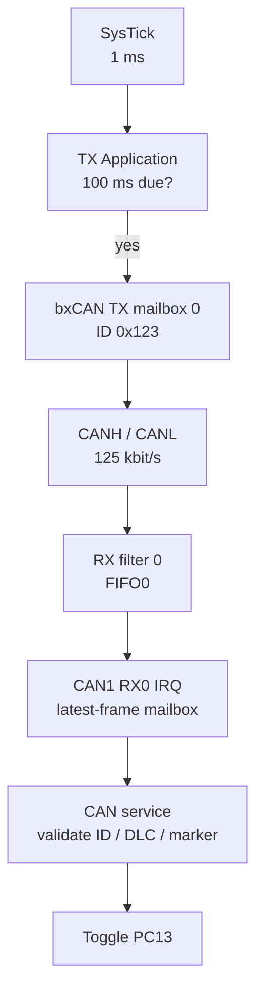

# 09 - CAN Bus - bxCAN TX/RX with MCP2551

> **Scope:** bxCAN at 125 kbit/s on two STM32F103 nodes, PB8/PB9 remapping, exact standard-ID filtering, TX mailbox polling, RX FIFO0 interrupt handoff, and PC13 receive indication.

[Root](../../README.md) · [Examples](../README.md) · [Architecture](docs/architecture.md) · [Porting](docs/porting_guide.md)

## Table of contents

- [Purpose and expected behavior](#purpose-and-expected-behavior)
- [Hardware and wiring](#hardware-and-wiring)
- [Configuration](#configuration)
- [Runtime flow](#runtime-flow)
- [Register-level mechanism](#register-level-mechanism)
- [Initialization and failure propagation](#initialization-and-failure-propagation)
- [Concurrency and ownership](#concurrency-and-ownership)
- [Observability and debugging](#observability-and-debugging)
- [Design trade-offs and limitations](#design-trade-offs-and-limitations)
- [Build and run](#build-and-run)
- [References](#references)

## Purpose and expected behavior

This example is stage 09 of the repository's progressive register-level series. It keeps the same self-managed startup, linker, layer checker, RCC fallback policy, system composition root, and super-loop used by the other projects, then changes the peripheral/dataflow problem under study.

bxCAN at 125 kbit/s on two STM32F103 nodes, PB8/PB9 remapping, exact standard-ID filtering, TX mailbox polling, RX FIFO0 interrupt handoff, and PC13 receive indication.

The important learning objective is not only “make the peripheral work.” The example is structured so that register knowledge remains concentrated in MCAL/platform code while Application expresses the observable behavior. Read the implementation from `system_init.c` downward and then compare the ownership discussion in [docs/architecture.md](docs/architecture.md).

## Hardware and wiring

```text
Blue Pill TX            MCP2551 TX       MCP2551 RX            Blue Pill RX
PB9 / CAN_TX ----------> CTX             CTX <---------------- PB9 / CAN_TX
PB8 / CAN_RX <---------- CRX             CRX ----------------> PB8 / CAN_RX
5 V -------------------- VCC             VCC ----------------- 5 V
GND -------------------- GND ----------- GND ----------------- GND

                       CANH ----------- CANH
                       CANL ----------- CANL
               120 ohms at each physical bus end

RX board PC13 onboard LED: toggle on a valid CAN frame.
```

Use **one 120-ohm termination at each physical bus end**; with both nodes unpowered, the measured resistance across CANH/CANL was about 60 ohms. MCP2551 modules require a 5 V supply; verify the module's CRX electrical levels against the STM32 input limits. ST-Link SWD uses PA13/PA14 plus ground/reference.

## Configuration

| Setting | Value |
|---|---|
| CAN instance / pins | CAN1, PB8 RX / PB9 TX (AFIO remap) |
| nominal bit rate | 125 kbit/s |
| APB1 clock | 36 MHz normal / 8 MHz fallback |
| bit timing | 16 TQ, BS1=13, BS2=2, SJW=1 |
| CAN prescaler | 18 normal / 4 fallback |
| standard data frame | ID `0x123`, DLC 2, `[counter, 0x11]` |
| TX schedule | 100 ms, 1 kHz SysTick |
| RX path | filter bank 0, FIFO0, RX0 IRQ priority 2 |
| TX mode | mailbox 0; NART and ABOM enabled |
| build role | `NODE=tx` or `NODE=rx` |
| common linker ceiling | 32 KiB Flash / 10 KiB RAM |

Configuration is deliberately split by ownership:

- `config/board_config.h` describes board/peripheral timing and physical integration policy;
- `config/mcal_config.h` contains MCU-driver limits such as timeout counts, buffer sizes, or IRQ priority when appropriate;
- `config/service_config.h` contains service-level capacity/policy;
- `config/application_config.h` contains product/demo behavior.

Compile-time checks reject several invalid combinations before register programming begins. These guards are part of the example contract and should be updated together with a port, not bypassed casually.

## Runtime flow



The TX node polls mailbox completion in thread mode, while RX0 ISR hands a frame to the service through a one-entry mailbox. The receiver acknowledges valid bus traffic in normal CAN mode but does not schedule application transmissions.

The common boot path is still:

```text
Reset_Handler
    -> runtime_init()
        -> copy .data
        -> zero .bss
        -> main()
            -> IRQ disabled
            -> system_init()
            -> IRQ enabled only after success
            -> application_process() forever
```

Concrete examples use `cortex_m3_nop()` in `system_idle()` so the core remains running between super-loop iterations, which is convenient for the repository's expected ST-Link/debug setup.

## Register-level mechanism

### Clock, remap and bit timing

MCAL enables AFIO and CAN1 clocks, maps CAN pins onto PB8/PB9, resets CAN1, then enters initialization mode through `MCR.INRQ` and a bounded wait for `MSR.INAK`. GPIO configures PB8 as input and PB9 as alternate-function push-pull. The CAN baud rate is derived from the **active** APB1 clock: `36 MHz / (18 * 16)` and `8 MHz / (4 * 16)` both give 125 kbit/s. BS1=13 and BS2=2 yield an 87.5% nominal sample point.

### Acceptance filter and RX interrupt

Filter bank 0 uses a 32-bit mask for standard data identifier `0x123` and routes accepted frames to FIFO0. The `USB_LP_CAN1_RX0_IRQHandler` handler removes up to three pending frames, releasing each FIFO entry and publishing the latest one into a static board mailbox. Frame validation and PC13 indication occur later in thread mode.

### TX mailbox and completion

`mcal_can_transmit()` validates the 11-bit ID and DLC, packs payload bytes into `TDLR`/`TDHR`, and requests transmission through mailbox 0. `mcal_can_poll_tx()` tests the request-complete and TXOK flags, then returns a completion or error state. Non-automatic retransmission (NART) is enabled, so missing acknowledgment can surface as a failed transmission rather than an unbounded retry.

### Register ownership boundary

The device model under `platform/device/stm32f103xb/` contains only the register structs, memory addresses, bit masks, and IRQ identities required by the example. MCAL performs reads/writes on that model. BSP binds MCAL capabilities to Blue Pill resources. ECUAL, where present, implements external-device protocol. Services and Application do not include raw STM32 register headers.

This is a deliberate compromise between two bad extremes: hiding all registers behind a vendor framework, and scattering register writes throughout application code.

## Initialization and failure propagation

`system/system_init.c` is the composition root. Initialization is bottom-up: the board first establishes clocks/pins/peripherals, then services/ECUAL capabilities are initialized, then Application state is created. Any required lower-layer initialization returning false prevents the normal loop from starting.

Because `main()` disables interrupts before calling `system_init()`, an interrupt configured during board initialization does not execute until the entire initialization sequence succeeds and `main()` executes `cortex_m3_enable_irq()`. Code that needs a startup delay before that point must therefore use a mechanism independent of an interrupt tick unless it explicitly changes the contract.

Initialization failure is fail-closed: `main()` calls `system_panic()`, which disables interrupts and remains in a NOP loop. This is intentionally simple and debugger-visible; it is not a production recovery manager.

## Concurrency and ownership

SysTick advances the timebase asynchronously and CAN RX0 ISR publishes the newest frame into a single static mailbox. Thread mode uses a short PRIMASK-protected copy-and-clear operation to take ownership. If a newer frame replaces an unread one, a mailbox-overwrite counter increments; this is a **latest-frame-wins** design, not a lossless FIFO. TX scheduling, completion polling, frame checks, and LED toggling all run in thread mode.

For a deeper resource-by-resource ownership analysis, see [docs/architecture.md](docs/architecture.md).

## Observability and debugging

The project favors state that can be inspected directly in GDB without requiring a logging stack. Application-level `volatile` counters/status variables are used in examples where runtime observation is useful. The generated ELF also retains `-g3` debug information and the build emits a linker map and mixed source/disassembly listing.

On TX, inspect `application_can_tx_ok`, `application_can_tx_failed`, and `application_can_tx_busy`. On RX, inspect `application_can_rx_ok`, `application_can_rx_bad`, `application_can_rx_overruns`, and `application_can_last_counter`. Both nodes expose `application_can_esr`; the RX board toggles PC13 on each valid frame.

Typical debug path:

```text
ST-Link / SWD
    |
OpenOCD :3333
    |
GDB
    |
reset halt -> load -> break main -> continue
```

When debugging a peripheral, inspect from the architecture boundary outward:

1. active system/bus clock;
2. GPIO mode and peripheral clock enable;
3. peripheral configuration registers;
4. status/error flags;
5. MCAL state/counters;
6. service/Application state.

This avoids treating an Application symptom as proof of an Application bug.

Hardware testing recorded TX success 160, RX valid 86, zero counted errors/overwrites and `ESR=0` at the respective snapshots. Those snapshots were **not simultaneous** and do not establish a packet-loss rate. See [hardware validation](docs/hardware_validation.md).

## Design trade-offs and limitations

- The single latest-frame mailbox can overwrite an unread frame; its counter does not measure every possible hardware FIFO loss.
- RX0 ISR handles a bounded number of FIFO entries; validation and LED updates are deferred to thread mode.
- NART disables automatic retransmission, and bus-off/reset-recovery scenarios are outside the tested scope.
- Only Classical CAN standard 11-bit data frames are demonstrated; there is no ISO-TP or CANopen protocol.
- Hardware evidence covers short-run functional TX/RX, not a 10,000-frame endurance or zero-loss claim.
- The linker intentionally caps both builds at 32 KiB Flash and 10 KiB RAM for the smaller tested board.

These limitations are intentional study boundaries rather than hidden production claims. The example should be extended only after its current ownership and timing contracts are understood.

## Build and run

From this example directory, select the node role for each command:

```bash
make NODE=tx check-layers
make NODE=tx
make NODE=tx size
make NODE=tx flash

# Move ST-Link to the RX board before flashing
make NODE=rx check-layers
make NODE=rx
make NODE=rx size
make NODE=rx flash
```

Debug with:

```bash
make NODE=rx debug-server
# second terminal
make NODE=rx debug
```

The Makefile builds freestanding Cortex-M3 Thumb code, links with the project linker script and `libgcc`, and emits ELF/BIN/HEX/LST/map artifacts. `make` runs the layer checker before compilation. The role-specific outputs are `build/tx/` and `build/rx/`; `python3 tests/test_bit_timing.py` checks nominal timing.

## References

- [STMicroelectronics — STM32F1 Series Documentation](https://www.st.com/en/microcontrollers-microprocessors/stm32f1-series/documentation.html)
- [STMicroelectronics — RM0008: STM32F101/102/103/105/107 Reference Manual](https://www.st.com/resource/en/reference_manual/cd00171190-stm32f101xx-stm32f102xx-stm32f103xx-stm32f105xx-and-stm32f107xx-advanced-armbased-32bit-mcus-stmicroelectronics.pdf)
- [STMicroelectronics — STM32F103C8 Product Page](https://www.st.com/en/microcontrollers-microprocessors/stm32f103c8.html)
- [Arm — Cortex-M3 Devices Generic User Guide](https://developer.arm.com/documentation/dui0552/latest/)
- [GNU Binutils — GNU linker documentation](https://sourceware.org/binutils/docs/ld/)
- [OpenOCD User's Guide](https://openocd.org/doc/html/)
- [Microchip — MCP2551 CAN Transceiver](https://www.microchip.com/en-us/product/mcp2551)

---

[← 08 ADC DMA](../08-adc-dma/README.md) · [↑ Examples](../README.md) · [Architecture](docs/architecture.md) · [Porting](docs/porting_guide.md) · [Project template →](../../template/README.md)
